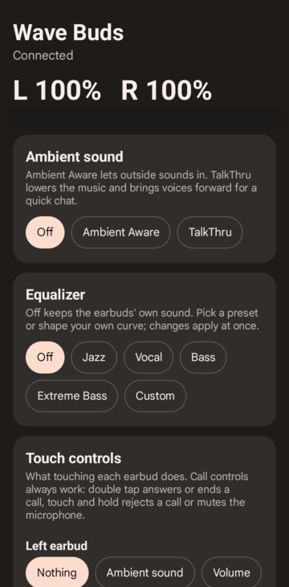

# Wave Buds: приложение для наушников JBL Wave Buds на Android

[English](README.md) | [Русский](README.ru.md)

**Wave Buds** — бесплатная альтернатива с открытым кодом официальному приложению **JBL Headphones** для оригинальных беспроводных наушников **JBL Wave Buds** (модель 2021 года, Bluetooth product id `0x2090`). Управление окружающим звуком (Ambient Aware, TalkThru), эквалайзер, жесты, VoiceAware, автовыключение и другое, заряд наушников, поиск потерянного наушника и автоматическое переподключение. APK весит около 58 КБ, без доступа в интернет, аналитики и аккаунтов; открывается мгновенно.



## Зачем

Официальное приложение весит около 200 МБ, и после запуска приходится ждать секунд 30, прежде чем можно что-то поменять. А когда наушники приходится сопрягать заново, их настройки могут сброситься.

Wave Buds держит в фоне маленький сервис с открытым каналом управления, поэтому приложение показывает всё сразу: подключение и чтение всех настроек занимает меньше секунды. Выбранные настройки хранятся в телефоне и записываются обратно в наушники при каждом подключении.

## Возможности

- **Заряд** левого и правого наушника, в приложении и в тихом уведомлении.
- **Окружающий звук**: выкл, Ambient Aware, TalkThru.
- **Эквалайзер**: выкл, четыре пресета JBL (Jazz, Vocal, Bass, Extreme Bass) или своя 10-полосная кривая (32 Гц–16 кГц, −8…+8 дБ).
- **Жесты** для каждого наушника: ничего, окружающий звук, громкость или воспроизведение (каждый вариант задаёт касание, двойное, тройное и удержание; в приложении расписано, что именно).
- **VoiceAware**: вкл/выкл и уровень низкий/средний/высокий.
- **Умное аудио и видео**: выкл, аудио (качество) или видео (меньше задержка). При переключении наушники перезапускаются, приложение переподключается само.
- **Голосовые подсказки**, **ограничитель громкости**, **автовыключение** (выкл, 30 мин, 1 ч, 2 ч).
- **Найти наушники**: громкий писк левого или правого.
- **Профиль настроек**: если наушники вернулись с другими настройками, приложение восстанавливает ваши.
- **Постоянная связь**: если наушники рядом, а звук не подключён, сервис подключает их; если телефон и наушники «забыли» друг друга, он снова сопрягает их, как только наушники окажутся в режиме сопряжения. Это можно выключить, если хотите отвязать наушники намеренно.
- **Журнал событий** для разбора проблем.
- Английский и русский язык, по языку системы.

## Установка

Скачайте со страницы [Releases](../../releases). Нужен Android 13 или новее.

**Обычный APK** (`WaveBuds.apk`, без root). Работает всё, с двумя отличиями от версии с root: при повторном сопряжении Android покажет обычное окно «Подключить?», которое нужно подтвердить, и приложение не может само принудительно подключить звук (нужно редко: сопряжённые наушники подключаются сами).

**Модуль Magisk** (`WaveBuds-magisk.zip`, root). Ставит приложение системным с правом `BLUETOOTH_PRIVILEGED`: сопряжение подтверждается без окон, и приложение само подключает звуковые профили. Установите zip в приложении Magisk и перезагрузитесь; чтобы удалить, удалите модуль. Если до этого стоял обычный APK, сначала удалите его.

### Первый запуск

Откройте приложение и разрешите «Устройства поблизости» (Bluetooth) и уведомления. Дальше сервис запускается сам после каждой перезагрузки. Не запрещайте ему работать в фоне: он использует экономное сканирование BLE с фильтром и почти всё время простаивает.

Наушники принимают только одно подключение управления, поэтому официальное приложение JBL и Wave Buds одновременно работать не могут.

## Сборка

Без Gradle: один скрипт вызывает инструменты SDK напрямую.

Нужны JDK 17+, Android SDK с `platforms;android-33` и `build-tools;35.0.0`, Python 3.

```sh
export ANDROID_SDK=~/Android/Sdk      # по умолчанию ~/.local/opt/android-sdk
./build.sh                            # -> out/WaveBuds.apk
./module/make-zip.sh                  # -> out/WaveBuds-magisk.zip
```

APK подписывается ключом `$WAVEBUDS_KEYSTORE` (по умолчанию `~/.android/wavebuds.jks`, создаётся при первой сборке). Не теряйте его: обновления должны быть подписаны тем же ключом.

Что где: `Proto.java` (кадры и кодирование), `BudsService.java` (логика подключения, профиль), `MainActivity.java` (интерфейс), `module/` (модуль Magisk).

## Протокол

Протокол управления (BLE GATT, кадры `aa <cmd> <len> <payload>`) описан в [docs/PROTOCOL.md](docs/PROTOCOL.md) (на английском), с реальными кадрами для каждой команды.

## Ограничения

- Только оригинальные Wave Buds (`0x2090`). У Wave Buds 2, Wave Buds 3 и других моделей JBL другие протоколы.
- Наушники отказываются от нового сопряжения, пока не находятся в режиме сопряжения, поэтому автоматическое пересопряжение ждёт этого момента. Они входят в него сами, когда теряют сопряжение; вручную: наушник в ухе, одно касание, затем касание с удержанием.
- Обновление прошивки не поддерживается, для этого есть официальное приложение.
- Проверено на одном телефоне (Android 13) с одной парой наушников.

## Отказ от ответственности

Проект не связан с JBL и Harman International и не одобрен ими. JBL — товарный знак своего владельца. Протокол описан по Bluetooth-трафику собственных наушников автора ради совместимости.

## Лицензия

[MIT](LICENSE)
