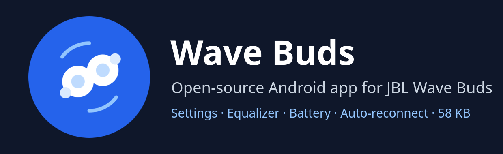

<p align="center">
  
</p>

<p align="center">
  <a href="../../releases/latest"></a>
  <a href="../../actions/workflows/build.yml"></a>
  
  
  
  <a href="LICENSE"></a>
</p>

<p align="center">
  <a href="README.md">English</a> · <b>Русский</b>
</p>

**Wave Buds** — бесплатная альтернатива с открытым кодом официальному приложению **JBL Headphones** для оригинальных беспроводных наушников **JBL Wave Buds** (модель 2021 года, Bluetooth product id `0x2090`). Окружающий звук (Ambient Aware, TalkThru), эквалайзер, жесты, VoiceAware, автовыключение, заряд наушников, поиск потерянного наушника и автоматическое переподключение. APK весит около 58 КБ, без доступа в интернет, аналитики и аккаунтов; открывается мгновенно.

<p align="center">
  
</p>

## Зачем

|  | JBL Headphones | Wave Buds |
|---|---|---|
| Размер | ~200 МБ | **58 КБ** |
| От запуска до смены настройки | ~30 с | **сразу** |
| Интернет, аналитика, аккаунт | есть | **нет** |
| Настройки после повторного сопряжения | могут сброситься | **восстанавливаются** |
| Сопряжение, если телефон и наушники «забыли» друг друга | вручную | **само** |

В фоне работает маленький сервис с открытым каналом управления, поэтому приложение показывает всё сразу: подключение и чтение всех настроек занимает меньше секунды. Выбранные настройки хранятся в телефоне и записываются обратно в наушники при каждом подключении.

## Возможности

| Функция | Что делает |
|---|---|
| 🔋 **Заряд** | Левого и правого наушника, в приложении и в тихом уведомлении. Наушник в кейсе показан прочерком. |
| 🌊 **Окружающий звук** | Выкл, Ambient Aware или TalkThru. |
| 🎚️ **Эквалайзер** | Выкл, четыре пресета JBL (Jazz, Vocal, Bass, Extreme Bass) или своя 10-полосная кривая, 32 Гц–16 кГц, −8…+8 дБ. |
| 👆 **Жесты** | Для каждого наушника: ничего, окружающий звук, громкость или воспроизведение; в приложении расписано, что делают касание, двойное, тройное и удержание. |
| 🗣️ **VoiceAware** | Вкл/выкл и уровень: низкий, средний, высокий. |
| 🎬 **Умное аудио и видео** | Выкл, аудио (качество) или видео (меньше задержка). Наушники перезапускаются, приложение переподключается само. |
| ⚙️ **Прочее** | Голосовые подсказки, ограничитель громкости, автовыключение (выкл, 30 мин, 1 ч, 2 ч). |
| 📍 **Найти наушники** | Громкий писк левого или правого. |
| 💾 **Профиль настроек** | Если наушники вернулись с другими настройками, приложение восстанавливает ваши. |
| 🔗 **Постоянная связь** | Подключает звук, если наушники рядом, а звук не подключён, и снова сопрягает их, если телефон и наушники «забыли» друг друга. Переключатель выключает это, когда вы отвязываете наушники намеренно. |
| 📝 **Журнал событий** | Для разбора проблем. Английский и русский язык, по языку системы. |

## Установка

Скачайте со страницы [последнего релиза](../../releases/latest). Нужен Android 13 или новее.

| | Обычный APK | Модуль Magisk |
|---|---|---|
| Файл | `WaveBuds.apk` | `WaveBuds-magisk.zip` |
| Root | не нужен | Magisk |
| Повторное сопряжение | Android покажет окно «Подключить?», его нужно подтвердить | подтверждается без окон, но только сопряжение, начатое самим приложением, и только при включённом переключателе |
| Подключение звука | делает Android (сопряжённые наушники подключаются сами) | приложение может подключить и само |
| Как поставить | установить APK | установить zip в приложении Magisk и перезагрузиться; обычный APK сначала удалить |

Модуль Magisk ставит приложение системным с правом `BLUETOOTH_PRIVILEGED`; от root оно не работает.

**Первый запуск.** Откройте приложение и разрешите «Устройства поблизости» (Bluetooth) и уведомления. Дальше сервис запускается сам после каждой перезагрузки. Не запрещайте ему работать в фоне: он использует экономное сканирование BLE с фильтром и почти всё время простаивает.

> [!NOTE]
> Наушники принимают только одно подключение управления, поэтому официальное приложение JBL и Wave Buds одновременно работать не могут. Чтобы воспользоваться одним, остановите другое.

## Приватность и безопасность

- Нет разрешения `INTERNET`, аналитики и аккаунтов. Резервное копирование Android для приложения выключено, так что его настройки (в том числе Bluetooth-адрес наушников) не попадают в облачную копию.
- Приложение трогает только **ваши** наушники: сопряжённые с этим телефоном или те, с которыми оно уже работало. Чужие Wave Buds рядом распознаются по их служебному кадру (и по метке имени телефона в рекламе) и остаются нетронутыми: приложение не записывает в них настройки и не пытается с ними сопрячься.
- Канал управления наушниками не защищён аутентификацией (так устроены сами наушники), поэтому приложение проверяет всё это до того, как что-либо прочитать или записать.

## Сборка

Без Gradle: один скрипт вызывает инструменты SDK напрямую.

Нужны JDK 17+ (релизы собираются на JDK 21), Android SDK с `platforms;android-33` и `build-tools;35.0.0`, Python 3.

```sh
export ANDROID_SDK=~/Android/Sdk      # по умолчанию ~/.local/opt/android-sdk
./test.sh                             # тесты протокола, обычная JVM
./build.sh                            # -> out/WaveBuds.apk
./module/make-zip.sh                  # -> out/WaveBuds-magisk.zip
```

APK подписывается ключом `$WAVEBUDS_KEYSTORE` (по умолчанию `~/.android/wavebuds.jks`, создаётся при первой сборке). Не теряйте его: обновления должны быть подписаны тем же ключом.

<details>
<summary><b>Проверить, что релиз собран из этих исходников</b></summary>

Сборка воспроизводимая: кроме подписи, APK из релиза байт в байт совпадает с тем, что `build.sh` собирает из коммита релиза на той же версии JDK и build-tools.

```sh
git checkout <коммит релиза>
./verify.sh ~/Downloads/WaveBuds.apk    # -> OK: identical apart from the signature
```

</details>

<details>
<summary><b>Что где лежит</b></summary>

| Путь | Что |
|---|---|
| `src/local/wavebuds/Proto.java` | кадры и кодирование, калибровка эквалайзера |
| `src/local/wavebuds/BudsService.java` | логика подключения, проверки доверия, профиль настроек |
| `src/local/wavebuds/MainActivity.java` | интерфейс |
| `tests/ProtoTest.java` | тесты протокола на реальных кадрах |
| `module/` | модуль Magisk |
| `docs/PROTOCOL.md` | протокол управления |

</details>

## Протокол

Протокол управления (BLE GATT, кадры `aa <cmd> <len> <payload>`) описан в [docs/PROTOCOL.md](docs/PROTOCOL.md) (на английском), с реальными кадрами для каждой команды.

## Ограничения

- Только оригинальные Wave Buds (`0x2090`). У Wave Buds 2, Wave Buds 3 и других моделей JBL другие протоколы.
- Наушники отказываются от нового сопряжения, пока не находятся в режиме сопряжения, поэтому автоматическое пересопряжение ждёт этого момента. Они входят в него сами, когда теряют сопряжение; вручную: наушник в ухе, одно касание, затем касание с удержанием.
- Обновление прошивки не поддерживается, для этого есть официальное приложение.
- Проверено на одном телефоне (Android 13) с одной парой наушников.

## Отказ от ответственности

Проект не связан с JBL и Harman International и не одобрен ими. JBL — товарный знак своего владельца. Протокол описан по Bluetooth-трафику собственных наушников автора ради совместимости.

## Лицензия

[MIT](LICENSE)
